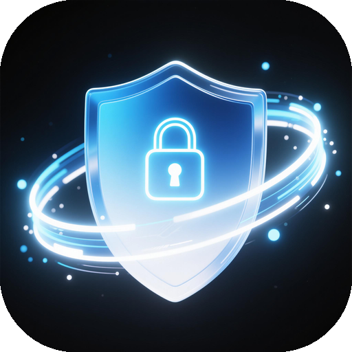

<div align="center">



# Trust2Pass

**Credential manager lokal-first berbasis Argon2id + AES-256-GCM** – vault terenkripsi, password generator, dan auto-lock, semuanya dari satu aplikasi desktop.

[](https://github.com/Mar0x02/Trust2Pass)


</div>

---

## Tentang

Trust2Pass adalah credential manager untuk penggunaan pribadi: satu vault terenkripsi, tersimpan lokal, tanpa server pusat. Tujuannya bukan mengejar fitur sebanyak mungkin, tapi memahami dan menerapkan dengan benar bagaimana sebuah aplikasi menyimpan rahasia secara aman — mulai dari derivasi kunci, enkripsi, sampai manajemen memori.

> ⚠️ **Status: Fase 1 MVP.** Belum untuk dipakai menyimpan password asli — belum diaudit.

## Fitur Inti (MVP)
- 🔐 Master password untuk membuka vault.
- 📋 CRUD entri kredensial: situs, username, password, URL, catatan.
- 🎲 Password generator berbasis modul `secrets`.
- ⏱️ Auto-lock otomatis setelah idle.
- 🌐 Multi-bahasa otomatis (Indonesia, Inggris, Mandarin, Jepang, Arab, Melayu — ngikutin bahasa sistem, bisa dioverride manual lewat tray icon) + layout RTL buat Arab.
- 🎨 Tema dark/light otomatis ngikutin sistem, live-update kalau diganti saat app jalan.
- 📥📤 Import/Export vault antar pengguna — Export bikin file baru dengan master password sendiri (gak pernah pakai ulang password vault aktif); Import HANYA menerima file hasil Export (ditandai lewat `kind` di header vault, dicek sebelum minta password sama sekali) dan melaporkan per-entri duplikat (sama persis di situs/username/password/URL) dengan opsi paksa-masukin.

## Desain Keamanan

| Aspek | Penerapan |
|---|---|
| **Confidentiality** | Argon2id (`argon2-cffi`) men-derive Master Key dari password — password tidak pernah dipakai langsung sebagai kunci enkripsi. |
| **Confidentiality** | AES-256-GCM (`cryptography`), AEAD — sekali jalan dapat kerahasiaan *dan* integritas. |
| **Integrity** | Header vault (magic, versi, parameter KDF, salt) di-*bind* sebagai AAD, jadi tidak bisa dimanipulasi tanpa ketahuan. |
| **Integrity** | Penulisan vault atomic (tulis sementara → fsync → rename) — tahan crash di tengah proses simpan. |
| **Availability** | Akses offline penuh, satu device, satu vault. |
| **Confidentiality** | Import cuma menerima file hasil fitur Export (flag `kind` di header vault, plaintext tapi tetap ke-cover AAD jadi gak bisa di-tamper diam-diam) — vault biasa ditolak sebelum minta password sama sekali, mencegah Import dipakai buat "menyedot" vault utama orang lain secara utuh. |
| **Confidentiality** | Export selalu minta master password BARU (gak pernah reuse password vault aktif) — file hasil export aman dibagikan tanpa membocorkan password vault utama. |
| **Trade-off sadar** | Fase 1 murni *zero-knowledge*: tanpa recovery key. Lupa master password = data hilang — ini keputusan desain, bukan bug. |

## Stack
Python + PySide6 — desktop native, cross-platform (Windows / macOS / Linux).

## Struktur Proyek
```
main.py                      entry point
generator.py                 password generator
crypto/                      KDF (Argon2id), cipher (AES-256-GCM), zeroize memori
vault/                       model entri & storage vault terenkripsi (format ber-versi, flag kind vault/export)
ui/main_window.py            dashboard utama (CRUD, panel detail, Import/Export)
ui/unlock_dialog.py          dialog unlock/buat vault/export/import (satu dialog, beberapa mode)
ui/entry_picker_dialog.py    checklist pilih entri buat Import/Export
ui/import_report_dialog.py   laporan hasil Import per-entri (sukses/duplikat)
ui/tray.py                   tray icon (lock, dashboard, pilihan bahasa)
ui/i18n.py                   terjemahan + auto-detect bahasa sistem
ui/datetime_fmt.py           format tanggal lokal + waktu relatif
ui/theme.py                  palette dark/light, varian tombol, stylesheet
assets/                      icon app (source, .ico, .icns, varian PNG)
```

## Menjalankan
```bash
pip install -r requirements.txt
python main.py
```

## Build & Release
Paket standalone (`.app`/`.dmg` macOS, `.msi` Windows, `.AppImage` Linux) dibuat lewat [Briefcase](https://briefcase.beeware.org/):
```bash
pip install briefcase
briefcase build macOS       # atau windows / linux
briefcase package macOS --adhoc-sign   # hasil di dist/
```
Push tag versi (`git tag v1.0.0 && git push --tags`) otomatis build ketiga platform via GitHub Actions dan attach ke GitHub Release (lihat `.github/workflows/release.yml`).

> ⚠️ Build macOS pakai **ad-hoc signing**, bukan Apple Developer certificate berbayar — user yang download bakal kena peringatan Gatekeeper "unidentified developer" pertama kali, perlu klik kanan → Open manual.

## Roadmap
1. **Fase 1 (MVP)** — vault lokal tunggal, zero-knowledge murni, fitur inti, multi-bahasa, Import/Export antar vault. *(sedang berjalan)*
2. **Fase 2** — recovery key sederhana, audit log, password health checker, MFA sebagai faktor kedua di atas Master Password (perlu desain terpisah soal gimana faktor ini masuk ke derivasi Master Key), dan mitigasi in-use-memory: exclude window dari screen-capture API (Windows/macOS) + macOS Secure Input Mode saat field master password fokus — mitigasi terhadap malware userspace (screen-scraper, event-tap keylogger), bukan garansi penuh.
3. **Fase 3** — multi-device sync terenkripsi end-to-end; auto-save & auto-fill credential via **browser extension** (native messaging ke app desktop, origin/domain-matching ketat). **Bukan** lewat OS Accessibility API/global hook: akses baca-tulis UI window app lain lewat Accessibility itu all-or-nothing di level OS (gak ada izin granular "cuma buat autofill"), jadi satu-satunya "pembatasan" ada di kode aplikasi sendiri — bukan dijamin OS — dan ilang begitu kodenya ke-compromise (bug, supply chain, dsb). Secara teknis pattern itu identik dengan keylogger/credential-stealing malware, jadi sengaja dikeluarkan dari scope.
4. **Fase 4** — porting logika inti ke Rust/Tauri untuk keamanan memori yang lebih ketat.

## Palette — Midnight Obsidian
| | Hex | Peran |
|---|---|---|
| ⬛ | `#0C0F14` | Background gelap |
| ⬛ | `#151B23` | Background sekunder / card |
| 🟦 | `#65D0EA` | Aksen cyan |
| 🟦 | `#3662E3` | Aksen biru |
| ⬜ | `#F2F5F9` | Teks / foreground terang |

## Lisensi
MIT — lihat [LICENSE](LICENSE).
